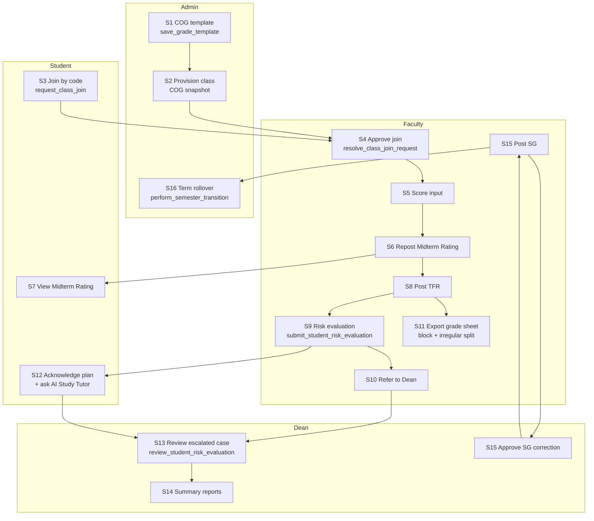

# ASPIRE defense audit — system inventory, workflow, and demo package

- **Date:** 2026-10-19
- **Purpose:** Capstone defense preparation. Documents how ASPIRE actually works, from evidence in the codebase.
- **Method:** every claim cites a file path and function or line range. No citation means it is not in this document.
- **Defense format / length:** not specified by the owner, so there is no timing plan in §3.
- **Live demo:** yes. Steps are tagged `[LIVE DEMO]` or `[SLIDE ONLY]`.

## Runtime verification status — read this first

| Ran | Result |
|---|---|
| `npm run lint` | 0 errors, 61 pre-existing warnings |
| `npm run build` | Succeeds |
| `npm run verify:grading` | Passes (5 presets, policy scale, attendance, honors, risk boundaries, milestone identity, summer isolation) |
| `npm run verify:csv` | Passes |

**The application was not run in a browser and no role was signed in during this audit.** No UI flow, RPC, RLS policy, or notification below is runtime-verified — all of it is read from source. `IMPLEMENTED` means the UI, logic, and data call all exist and reference each other in code. Treat this as the primary caveat of this document.

Owner-confirmed on 2026-10-19: all 65 migrations are applied to the remote project, SMTP is enabled, the AI model runs correctly, the AI Study Tutor works, the College Office portal is discarded, and the demo runs on the current working tree (which includes the uncommitted faculty export split).

---

# 1. Inventory

## 1.A Roles

Four roles. Role comes from `users.role`, read into context as `userProfile?.role ?? null` ([`AuthContext.jsx:359`](../../../src/lib/AuthContext.jsx)) — **not** from a JWT claim, so every gate depends on a `users` row read.

| Role | Assigned by | Enforced at |
|---|---|---|
| `admin` | `ROLES` dropdown, [`UserForm.jsx:13-18`](../../../src/pages/admin/UserForm.jsx); written by `create-admin-user` edge function (`index.ts:75`) | `RoleGuard allowedRoles={['admin']}` [`App.jsx:120`](../../../src/App.jsx); DB `is_active_admin()` |
| `dean` | same dropdown; department link via `assign_department_dean` (`20261011140000_admin_batch3_atomic_saves.sql:118`) | `RoleGuard` `App.jsx:140`; `is_authorized_dean_for_class()`, `is_authorized_dean_for_student()` |
| `faculty` | same dropdown | `RoleGuard` `App.jsx:154`; `is_assigned_faculty()` |
| `student` | same dropdown, default `role: 'student'` (`UserForm.jsx:58`) | `RoleGuard` `App.jsx:174`; `is_student_enrolled_in_class()` |

Three enforcement layers:

1. **Route guard** — [`RoleGuard.jsx`](../../../src/components/layout/RoleGuard.jsx): no session → `/login`; no role → spinner; role not allowed → `/403`.
2. **Database RLS** — ~77 policies across the migrations, built on five SECURITY DEFINER helpers: `is_active_admin`, `is_assigned_faculty`, `is_authorized_dean_for_class`, `is_authorized_dean_for_student`, `is_student_enrolled_in_class`.
3. **Privileged writes** — SECURITY DEFINER RPCs rather than direct table writes (27 RPCs, §1.D).

**Self-escalation is closed.** `20261014120000_harden_users_rls.sql` re-enables RLS on `users` and adds trigger `prevent_self_role_escalation()`, raising `42501` when a non-admin changes `role` or `status`. The migration header documents the exact hole it closed:

```js
supabase.from('users').update({ role: 'admin' }).eq('user_id', <own uid>)
```

**Documented residual:** `users_select_authenticated` is `USING (true)` — any authenticated user can read any user row. The migration explains why (faculty rosters and notification fan-out depend on it) and defers narrowing to a separate change. See §3.5 Q7.

## 1.B Features per role

Status method: a screen is `IMPLEMENTED` if it has a route, is reachable from navigation or an in-page link, and calls Supabase or a `src/lib` service. There are **zero** `TODO`/`FIXME`/`HACK` comments and **zero** "coming soon" / "not implemented" strings in `src/`.

### Admin — 16 routes, `App.jsx:120-136`

| Screen | Route | File | Status |
|---|---|---|---|
| Dashboard | `/admin/dashboard` | `admin/Dashboard.jsx` | IMPLEMENTED |
| User list | `/admin/userlist` | `admin/UserList.jsx` (2,962 lines) | IMPLEMENTED |
| User form | `/admin/userform` | `admin/UserForm.jsx` | IMPLEMENTED |
| Grade override | `/admin/gradeoverride` | `admin/GradeOverride.jsx` | IMPLEMENTED — `apply_admin_grade_override` |
| Audit log | `/admin/auditlog` | `admin/AuditLog.jsx` | IMPLEMENTED |
| Subject list / form | `/admin/subjectlist`, `/admin/subjectform` | `admin/SubjectList.jsx`, `SubjectForm.jsx` | IMPLEMENTED |
| Section list / form | `/admin/sectionlist`, `/admin/sectionform` | `admin/SectionList.jsx`, `SectionForm.jsx` | IMPLEMENTED |
| Section masterlist | `/admin/sectionmasterlist` | `admin/SectionMasterlist.jsx` | IMPLEMENTED — `getSectionIrregularEnrollees` |
| Term management | `/admin/termmanagement` | `admin/TermManagement.jsx` | IMPLEMENTED — `perform_semester_transition` |
| COG templates | `/admin/gradecomputationslist` | `admin/GradeComputationsList.jsx` | IMPLEMENTED — `save_grade_template` |
| Departments | `/admin/departmentslist` | `admin/DepartmentsList.jsx` | IMPLEMENTED |
| Classroom provisioning | `/admin/classrooms` | `admin/ClassroomProvisioning.jsx` | IMPLEMENTED |
| Notifications | `/admin/notifications` | `admin/Notifications.jsx` | IMPLEMENTED |
| Settings | `/admin/settings` | `shared/Settings.jsx` | IMPLEMENTED |

### Dean — 10 routes, `App.jsx:140-150`

| Screen | Route | File | Status |
|---|---|---|---|
| Dashboard | `/dean/dashboard` | `dean/Dashboard.jsx` | IMPLEMENTED |
| Grade posting status | `/dean/gradepostingstatus` | `dean/GradePostingStatus.jsx` | IMPLEMENTED — `get_term_sg_status` |
| SG correction requests | `/dean/remarkoverriderequests` | `dean/RemarkOverrideRequests.jsx` | IMPLEMENTED — `review_sg_correction_request` |
| Grade distribution | `/dean/gradedistribution` | `dean/GradeDistribution.jsx` | IMPLEMENTED |
| At-risk students | `/dean/atriskstudents` | `dean/AtRiskStudents.jsx` | IMPLEMENTED |
| Escalated cases | `/dean/escalatedcases` | same file, `initialTab="discussion_queue"` | IMPLEMENTED |
| Intervention results | `/dean/interventionresults` | same file, `initialTab="outcomes_tracker"` | IMPLEMENTED |
| Summary reports | `/dean/summaryreports` | `dean/SummaryReports.jsx` | IMPLEMENTED |
| Notifications / Settings | `/dean/notifications`, `/dean/settings` | — | IMPLEMENTED |

### Faculty — 16 routes, `App.jsx:154-170`

| Screen | Route | File | Status |
|---|---|---|---|
| Dashboard | `/faculty/dashboard` | `faculty/Dashboard.jsx` | IMPLEMENTED |
| Class records | `/faculty/classrecordslist` | `faculty/ClassRecordsList.jsx` | IMPLEMENTED |
| COG components setup | `/faculty/gradecomponentssetup` | `faculty/GradeComponentsSetup.jsx` | IMPLEMENTED |
| Score input | `/faculty/scoreinput` | `faculty/ScoreInput.jsx` (3,280 lines) | IMPLEMENTED |
| Grade computation preview | `/faculty/gradecomputationpreview` | `faculty/GradeComputationPreview.jsx` | IMPLEMENTED — `post_grade_milestone_atomic` |
| Posted grades | `/faculty/postedgradesview` | `faculty/PostedGradesView.jsx` | IMPLEMENTED |
| Evaluate student | `/faculty/evaluatestudent` | `faculty/StudentRisk.jsx`, `StudentRiskEvaluationModal.jsx` | IMPLEMENTED — `submit_student_risk_evaluation` |
| Evaluated students | `/faculty/evaluatedstudents` | `faculty/EvaluatedStudents.jsx` | IMPLEMENTED |
| Consultations | `/faculty/consultations` | `faculty/ConsultationRequests.jsx` | IMPLEMENTED |
| Enrollment requests | `/faculty/enrollmentrequests` | `faculty/EnrollmentRequests.jsx` | IMPLEMENTED — `resolve_class_join_request` |
| Class attendance | `/faculty/classattendance` | `faculty/ClassAttendance.jsx` | IMPLEMENTED — `get_class_attendance_roster` |
| Class performance | `/faculty/reports/class-performance` | `faculty/ClassPerformance.jsx` | IMPLEMENTED |
| Performance comparison | `/faculty/reports/comparison` | `faculty/PerformanceComparison.jsx` | IMPLEMENTED |
| At-risk (legacy) | `/faculty/atriskstudents` | `LegacyStudentRiskRedirect`, `App.jsx:73-78` | IMPLEMENTED — intentional redirect |
| Notifications / Settings | — | — | IMPLEMENTED |

### Student — 11 routes, `App.jsx:174-185`

| Screen | Route | File | Status |
|---|---|---|---|
| Dashboard | `/student/dashboard` | `student/Dashboard.jsx` | IMPLEMENTED |
| My subjects | `/student/mysubjects` | `student/MySubjects.jsx` | IMPLEMENTED |
| My grades list / detail | `/student/mygradeslist`, `/student/mygradesdetail` | `student/MyGradesList.jsx`, `MyGradesDetail.jsx` | IMPLEMENTED |
| Advising inbox | `/student/advising-inbox` | `student/FacultyAdvisingInbox.jsx` | IMPLEMENTED — `acknowledge_student_evaluation` |
| AI Study Tutor | `/student/academic-insights` | `student/AcademicInsights.jsx` (2,398 lines) | IMPLEMENTED (owner-confirmed) |
| Consultations | `/student/consultations` | `student/Consultations.jsx` | IMPLEMENTED |
| Attendance | `/student/attendance` | `student/Attendance.jsx` | IMPLEMENTED |
| AI recommendation (legacy) | `/student/airecommendation` | redirect, `App.jsx:182` | IMPLEMENTED — intentional redirect |
| Notifications / Settings | — | — | IMPLEMENTED |

## 1.C Data lifecycle

27 tables appear in `supabase.from(...)` calls. These carry state machines:

| Record | Field | Allowed values | Changed by | Function |
|---|---|---|---|---|
| `student_risk_evaluations` | `status` | `draft`, `submitted`, `acknowledged_by_student` | faculty submits, dean reviews, student acknowledges | `submit_student_risk_evaluation`, `review_student_risk_evaluation` (`20260926120000:385`), `acknowledge_student_evaluation` |
| same | `refer_to_dean`, `requires_tutoring` | boolean | faculty / dean | `review_student_risk_evaluation` |
| `student_evaluation_referrals` | `state` | `pending`, `resolved` | faculty refers, dean resolves | `refer_student_evaluation_to_dean`; `referEvaluation()` `evaluationService.js:114` |
| `remark_override_requests` | `status` | `pending`, `approved`, `rejected`, `applied`, `cancelled` | faculty submits, dean decides, faculty applies | `submit_sg_correction_request`, `review_sg_correction_request`, `cancel_sg_correction_request` |
| `class_join_requests` | `status` | `pending`, `approved`, `rejected` | student requests, assigned faculty decides | `request_class_join`, `resolve_class_join_request`, `dismiss_class_join_request` |
| `student_consultation_requests` | `status` | `pending`, `scheduled`, `completed`, `declined` | student creates, faculty updates | direct table update, `ConsultationRequests.jsx:126` — **not an RPC** |
| `posted_grades` | `grade_period` | `prelim`, `midterm`, `semi_final`, `final`, `midterm_rating`, `tentative_final_rating`, `semestral_grade` | faculty | `post_grade_milestone_atomic` |
| `class_records` | `status` | `active`, `archived`, `late`, `late_overdue` — **no CHECK constraint** | system on rollover | `20261011130000_term_rollover_grace.sql:218`; read by `getClassTermState()` |
| `enrollments` | `status` | `active`, `pending_verification`, `rejected` | admin / faculty | `20260819000000:70` |
| `faculty_intervention_drafts` | `status` | `generated`, `accepted`, `discarded`, `superseded` | faculty | `generate-intervention-draft` |
| `faculty_intervention_working_drafts` | `status` | `active`, `submitted` | faculty | `save_faculty_intervention_working_draft` |
| `notification_deliveries` | `status` | `pending`, `processing`, `sent`, `failed`, `cancelled` | system / `send-email` | `requeue_notification_delivery` |
| `users` | `status` | `active`, `inactive`, `archived` — **no CHECK constraint** | admin only (trigger-protected) | `AuthContext.jsx:90`, `MainLayout.jsx:28` |

Term progression: **Prelim → Midterm → Semi-Final → Final**. Milestones MR / TFR / SG frozen in `GRADE_MILESTONES` (`gradeMilestones.js:1-5`).

### Grade posting authority — the critical distinction

`post_grade_milestone_atomic` (`20261008150000_atomic_grade_milestone_posting.sql`) accepts only `midterm_rating`, `tentative_final_rating`, `semestral_grade` (line 49) and requires:

- the class to be `status = 'active'` and the actor to be its active assigned faculty (lines 75-84);
- a COG whose component weights total 100% (line 111);
- the submitted COG to match the immutable class snapshot (line 118) — "The submitted COG differs from the class grading snapshot";
- every student to be enrolled in the class (lines 146, 249).

It then upserts `ON CONFLICT (class_record_id, grade_period, student_id) DO UPDATE` (line 266).

**Consequence, and the single most important fact for the defense:**

| Milestone | Repost after posting | Approval needed |
|---|---|---|
| Midterm Rating (MR) | Yes — plain upsert, overwrites `computed_grade`, `remarks`, `posted_by`, `posted_at`, re-snapshots the COG | **None** |
| Tentative Final Rating (TFR) | Yes — same | **None** |
| Semestral Grade (SG) | **Blocked at the database level** | **Dean approval required** |

SG is protected by trigger `trg_enforce_sg_correction_application` on `posted_grades` (`20261008160000_sg_correction_integrity.sql:397-512`), which enforces:

- identity fields (`posted_grade_id`, `class_record_id`, `student_id`, `grade_period`) are immutable (line 413);
- an `approved` `remark_override_requests` row must exist for that exact `posted_grade_id`, selected `FOR UPDATE` (lines 458-467);
- only the assigned faculty may apply it — `admin` returns early, which is the documented override path (lines 448-456);
- the corrected percentage, GWA, and remark must each match the approved proposal exactly (lines 472-501);
- the corrected SG must be reposted and relocked in the same transaction (line 469);
- an unchanged repost cannot consume or relock an approval (line 433).

`grade_correction_history` is append-only, protected by `trg_prevent_grade_correction_history_mutation` (line 574).

## 1.D Hand-offs

21 dispatchers in [`notificationDispatcher.js`](../../../src/lib/notificationDispatcher.js). Role-to-role hand-offs:

| # | From → To | Trigger | Mechanism | Evidence |
|---|---|---|---|---|
| 1 | Student → Faculty | Student enters a join code | `class_join_requests` status `pending` | `request_class_join`, `classRoomService.js:153` |
| 2 | Faculty → Student | Faculty approves / rejects | status → `approved` / `rejected`; enrollment created | `resolve_class_join_request`, `classRoomService.js:443` |
| 3 | Faculty → Student | Grade milestone posted | `posted_grades` row; student grade screens unlock | `notifyGradesPosted:177`, `notifyGradePosted:665` |
| 4 | Faculty → Dean | Faculty refers an evaluation | `student_evaluation_referrals` state `pending` → Escalated Cases | `refer_student_evaluation_to_dean` |
| 5 | Faculty → Student | Risk evaluation submitted | `student_risk_evaluations` status `submitted` → Advising Inbox | `submit_student_risk_evaluation` |
| 6 | Student → Faculty | Student acknowledges the plan | status → `acknowledged_by_student` | `acknowledge_student_evaluation` |
| 7 | Faculty → Dean | SG correction requested | `remark_override_requests` status `pending` | `notifyOverrideRequested:376` |
| 8 | Dean → Faculty | Dean decides | status → `approved` / `rejected` | `notifyOverrideApproved:419`, `notifyOverrideRejected:446` |
| 9 | Faculty → Dean + Student | Corrected SG reposted | status → `applied` | `notifyOverrideApplied:466` |
| 10 | Student → Faculty | Consultation requested | `student_consultation_requests` status `pending` | `Consultations.jsx:142` |
| 11 | Faculty → Student | Scheduled / declined | status + `scheduled_at` | `ConsultationRequests.jsx:126` |
| 12 | Admin → All | Term activation / rollover | `academic_terms`; classes → `archived` | `perform_semester_transition`, `notifyTermActivated:602` |
| 13 | Admin → Faculty + Student | Roster import | enrollments created | `notifyRosterImported:632` |
| 14 | Admin → Faculty + Student | Admin grade override | `grade_correction_history` | `apply_admin_grade_override`, `notifyAdminGradeOverride:548` |
| 15 | Admin → User | Account enable / disable / archive | `users.status` | `notifyUserStatusChange:295` |

Email leaves through the `send-email` edge function via `notification_deliveries`.

## 1.E Dead ends

Navigation link sets were checked against the route table. **No broken navigation was found.** Two apparent dead ends are not:

| Candidate | Verdict |
|---|---|
| `/faculty/gradecomponents`, `/faculty/classrecords`, `/student/mygrades`, `/admin/user`, `/faculty/postedgrades`, `/dean/gradeposting` appear in nav with no route | Not dead ends — they are `startsWith()` active-tab matchers, `BottomNav.jsx:22,28,40` |
| `*/notifications`, `*/settings`, `/admin/userform`, `/sectionform`, `/subjectform` absent from the sidebar | Reachable — `Topbar.jsx:103,121`; `Dashboard.jsx:418-446`; `SectionList.jsx:290` |

Genuine findings:

| Finding | Status | Evidence |
|---|---|---|
| `getBoundedAdvisorResponse(question, context)` always returns `null`; both parameters unused; its only caller falls straight through | **UNUSED** dead branch | `openrouter.js:59-64` |
| `sendTestNotification(role, delayMs)` has **no callers anywhere in `src/`** | **UNUSED** | `notificationService.js:123`. Its hard-coded sample names are intentional demo copy, not a data fallback, so they are not a §4 flaw — but the function is unreachable. Likely intended for a "send test notification" button that was never wired up. |
| `Subject Profile` sheet has a fixed 30+30 = 60-student grid; a larger section is silently truncated on that sheet | **PARTIAL** | `excelExport.js:283-300` |
| `PostedGradesView` does not de-duplicate its roster, unlike the other two export screens | **PARTIAL** | `PostedGradesView.jsx:461` |
| Hard-coded reference and identity data | **MOCK/HARDCODED** | §4 |

No state is stranded: every status value in §1.C has a forward path except the terminal ones (`applied`, `cancelled`, `rejected`, `resolved`, `acknowledged_by_student`, `archived`).

---

# 2. Workflow

One continuous chain, one sample case: **one student, one subject, one class, Midterm already posted** (the owner-confirmed starting data state). Only `IMPLEMENTED` features appear. Known limitations are in §2.2.

## Demo accounts — do not trust the repo

**The database was cleaned out in the week before 2026-10-19.** The demo users and the `DemoPassword123!` password documented in `AGENTS.md`, and the seed accounts in `src/lib/seedDatabase.js`, **no longer work.** The live accounts use a different convention (`@dyci.edu.ph`, as the §6.2 dean query showed). The owner confirms they hold access to all current active accounts.

So this document deliberately names only accounts verified against the live database, and gives you a query for the rest instead of stale literals:

```sql
-- The real active accounts, by role, with their college
SELECT u.role,
       u.email,
       u.user_number,
       u.status,
       d.name AS college
FROM public.users u
LEFT JOIN public.departments d ON d.department_id = u.department_id
WHERE u.status = 'active'
ORDER BY u.role, u.email;
```

**Verified against the live `users` table, 2026-10-19.** All of these are `active` with `must_change_password = false`, so they sign straight in:

| Role | Account to use |
|---|---|
| Admin | `admin@sage.edu.ph` |
| Faculty (TECH) | `a.rivera@sage.edu.ph` |
| Student (TECH) | `j.abad@dyci.edu.ph` (or `r.gatchalian@`, `andrew.quezon@`, `abalos.carl@`) |
| **Dean (TECH)** | **`tech.dean@dyci.edu.ph`** — owns BSIT-1A/1B/2A. The account for every Dean step |
| Dean (CME) | `maritime.dean@dyci.edu.ph` — owns BSMARE-1A/1B. Only needed for the §3.1a exhibit |

Most other accounts have `must_change_password = true` and will land on the forced-change screen instead of their portal — avoid them on stage.

Two of `AGENTS.md`'s four demo users **no longer exist**: `c.valdes@sage.edu.ph` and `s.jenkins@student.sage.edu`. `admin@sage.edu.ph` and `a.rivera@sage.edu.ph` do still exist — only the passwords changed. The full account list is in [`04-testing/QA_CHECKLIST_2026-10-19.md`](../../04-testing/QA_CHECKLIST_2026-10-19.md) §0.1.

**Dean — depends on the class you demo.** Verified against the live database 2026-10-19: **ten colleges exist, each with its own active dean**, but only **two currently hold active classes** — so only these two matter for the demo.

| College | Sections | Dean to sign in as |
|---|---|---|
| Technology and Engineering College for Humanity | BSIT-1A, BSIT-1B, BSIT-2A | `tech.dean@dyci.edu.ph` |
| College of Maritime Education | BSMARE-1A, BSMARE-1B | `maritime.dean@dyci.edu.ph` |

**`c.valdes@sage.edu.ph` is NOT one of them**, despite being listed as the dean demo user in `AGENTS.md` — that list is stale. Since the SG-correction request is now locked to the owning college's dean (§6.2), signing in as `c.valdes` would show an **empty Dean queue** and the hand-off would look broken on stage. Use the dean from the table that matches your demo class.

**Owner's demo plan (2026-10-19):** the end-to-end flow runs on a **TECH / BSIT** class, so the dean account for every Dean step is **`tech.dean@dyci.edu.ph`**. **CME / BSMARE** is used separately, read-only, to show that the two colleges carry **different grade computations** — see §3.1a.

**Access confirmed by the owner (2026-10-19):** they hold credentials for every current active account, including `tech.dean@dyci.edu.ph`. The SG-correction hand-off depends on that one account, so sign in as it once before rehearsing to be sure.

## 3.1a The COG contrast exhibit (TECH vs CME) `[LIVE DEMO]`

The strongest answer to "what stops a teacher from inventing their own grading weights?" is to show two colleges side by side with genuinely different component weights, both driven from the database rather than from code.

- **Screen:** `/admin/gradecomputationslist`, with `/faculty/gradecomponentssetup` as the faculty-side view
- **Point to make:** weights come from the class's COG template, snapshotted onto the class at creation. They are **not** a fixed 50/10/40, and a teacher cannot change them — posting validates the submitted COG against the stored class snapshot and rejects a mismatch with `23514` (`20261008150000:111,118`).
- **Talking point:** "Each college defines its own computation. The system stores it, snapshots it onto the class, and refuses to post a grade computed from anything else."

**Verified against the live database, 2026-10-19 — the contrast is real, and stronger than two templates.** Three distinct COG templates are in use, with different component *counts*, names, weights and max scores:

| College | Template | Subjects | Components |
|---|---|---|---|
| Technology & Engineering | **General Education Core** | DSA123, ITC113, ITP113, ITP123 | Class Standing (Formative) **50%** (max 20, multiple) · Major Examination **40%** (max 40) · Character Rating **10%** (max 100) |
| Maritime Education | **Maritime Lecture Scale** | AUX123, NAV113, SEA103 | Class Standing **60%** (max 100, multiple) · Major Examination **40%** (max 100) |
| Maritime Education | **Maritime Laboratory Scale** | MSH111, MSH122, SST103 | Demonstration of Competence **60%** (max 100) · Systematic Exercises **40%** (max 100, multiple) |

Three things to draw the panel's attention to, because each one answers a different anticipated question:

1. **Different number of components — three versus two.** This is the single clearest proof the engine is not a fixed formula. A hard-coded 50/10/40 cannot produce a two-component scale.
2. **Different component names.** Maritime's laboratory scale has no "Character Rating" at all; it has "Demonstration of Competence" and "Systematic Exercises". Component identity is data, not code — `createComponentKey` in `gradingMath.js` derives a stable key from whatever name the template carries.
3. **Different max scores for the same weight.** Maritime's Major Examination is 40% of a 100-point exam; TECH's is 40% of a 40-point exam. Weight and raw ceiling are independent fields.

Useful supporting fact: TECH's live **General Education Core** matches `OFFICIAL_DYCI_PRESETS[0]` in `src/lib/officialGradingPresets.js` exactly — 50/40/10 at max 20/40/100. So the preset shipped in code, the template in the database, and the fixtures asserted by `npm run verify:grading` are all the same institutional values. That is a strong answer to "how do you know your grading matches the handbook?"

This also retires a stale claim: `01-system/overview/ASPIRE_CONTEXT.md` still describes fixed 50/10/40 weights. The live data shows three dynamic templates, so that document is out of date, not the system.

To re-verify after any template change:

```sql
SELECT dep.name    AS college,
       s.code      AS subject,
       gc.name     AS cog_template,
       comp.name   AS component,
       comp.weight,
       comp.max_score,
       comp.is_multiple
FROM public.subjects s
JOIN public.departments dep ON dep.department_id = s.department_id
LEFT JOIN public.grade_computations gc
       ON gc.computation_id = s.computation_id
LEFT JOIN public.grade_computation_components comp
       ON comp.computation_id = gc.computation_id
ORDER BY dep.name, s.code, comp.weight DESC;
```

A `NULL` `cog_template` on any subject means its classes **cannot post grades** (`23514`, "A valid class or subject COG is required"). As of 2026-10-19 every subject in both active colleges has one.

## 3.1 Demo script

Accounts: use the table in §2.1. The repo's `DemoPassword123!` no longer works — the database was cleaned out shortly before 2026-10-19.

| # | Role | Account | Clicks | Type this | Expected on screen |
|---|---|---|---|---|---|
| 1 | Admin | Admin (see §2.1) | Login → Grade Computations → Apply Preset or New Template → add components → Save | A template name; component weights totalling 100 | Template saved; weight total validates to 100%. Safe — cannot affect the demo class, see §2.3 |
| 2 | Faculty | Faculty (see §2.1) | Login → Class Records → open the demo class → Score Input | Change one Midterm activity score | Recomputed term rating updates in the row |
| 3 | Faculty | same | Grade Computation Preview → Post → Midterm Rating → confirm | — | Success toast; posting count returned |
| 4 | Student | Student (see §2.1) | Login → My Grades → open the subject | — | Updated Midterm Rating and running GWA |
| 5 | Faculty | Faculty (see §2.1) | Grade Computation Preview → Post → Tentative Final Rating | — | TFR row posted and locked |
| 6 | Faculty | same | Evaluate Student → pick the at-risk student → fill plan + restricted note → Submit | Student-visible plan, and a faculty-only note | Evaluation saved, `submitted`; risk tier badge shown |
| 7 | Faculty | same | Evaluated Students → Refer to Dean | A referral reason | Referral created, state `pending` |
| 8 | Dean | `tech.dean@dyci.edu.ph` — owns the TECH/BSIT demo class | Login → Escalated Cases → open the case → set tutoring → Resolve | Resolution note | Case resolved; appears in Intervention Results |
| 9 | Student | Student (see §2.1) | Advising Inbox → Acknowledge → AI Study Tutor → ask a question | "Why is my standing at risk?" | Acknowledged; AI answer grounded in their own records |
| 10 | Faculty | Faculty (see §2.1) | Posted Grades on **DSA123 / BSIT-2A** → Export → Download Complete Workbook | — | 6 sheets. Official set = 10 BSIT-2A students; `(Irregular)` set = 1 (`andrew.quezon@`) |
| 11 | Faculty / Dean | either | Reports → Class Performance → Export; Dean → Summary Reports | — | Charts render; Excel downloads |

**Prove the SG lock without risking it live:** show the Dean's SG correction queue read-only and narrate §1.C. Do not attempt an unapproved SG repost on stage — it raises a database exception by design, and an error dialog in front of a panel reads as a bug even when it is the feature working.

## 3.2 Swimlane



## 3.3 Fallbacks per live step

| Step | If it fails live | Prepare |
|---|---|---|
| 1 Admin COG | Validation rejects weights ≠ 100 | Screenshot of a saved template; have a correct weight set written down |
| 2-3 Score + post MR | COG snapshot mismatch or network | Screenshot of the posted MR row; a second class already scored |
| 4 Student grade view | Session or cache | Screenshot of My Grades Detail |
| 5 Post TFR | Same as MR | Screenshot of both posted rows side by side |
| 6 Risk evaluation | Validation rejects empty plan or note | Pre-filled working draft (`faculty_intervention_working_drafts`), plus a screenshot |
| 7 Refer to Dean | Pending referral already exists | Screenshot of the Dean's Escalated Cases queue |
| 8 Dean review | Authorisation or data | Already-resolved case to show in Intervention Results |
| 9 AI Study Tutor | **Most likely to fail** — external provider | **Recorded clip.** Also narrate the non-AI fallback as a designed behaviour |
| 10 Export | Browser download blocked | Pre-generated workbook open on the desktop showing all 6 tabs |
| 11 Reports | Chart render or dataset | Pre-exported Excel + screenshots |

## 3.4 Things to have open before you start

- Four browser profiles or windows, one signed in per role, to avoid logout/login time on stage.
- A pre-generated 6-sheet workbook.
- A recorded clip of the AI Study Tutor answering.
- Screenshots for every row in §3.3.

## 3.5 Ten likely panel questions

**Q1. Can a teacher secretly change a grade after posting it?**
Interim ratings yes, the official grade no. MR and TFR upsert on repost and stamp `posted_by` / `posted_at` every time. The Semestral Grade is blocked by a database trigger, `trg_enforce_sg_correction_application`, which requires an `approved` correction request for that exact posted-grade row and rejects any repost whose percentage, GWA, or remark differs from what the Dean approved (`20261008160000_sg_correction_integrity.sql:397-512`).

**Q2. Where is authorisation enforced — only in the UI?**
Three layers. `RoleGuard` on routes; ~77 RLS policies built on five SECURITY DEFINER helpers; and privileged writes routed through 27 RPCs instead of direct table writes. The UI layer is convenience; removing it does not grant access.

**Q3. Could a student make themselves an admin?**
No. RLS is enabled on `users` and trigger `prevent_self_role_escalation()` raises `42501` if a non-admin changes `role` or `status`. The migration documents the exact call it blocks. Honest note: this was a real hole, found in our own audit and closed on 2026-10-14.

**Q4. How is the risk score calculated, and is it a black box?**
Not a black box. Four weighted factors — GWA 60, attendance 50, missing work 15, trajectory 10 — summed and capped at 100, with tiers Low 0-24, Moderate 25-49, High 50-74, Critical 75-100 (`riskEngine.js:21-26`). Each factor and the raw inputs are stored in `risk_breakdown` on every evaluation, so any score can be reconstructed. Boundaries are asserted by `npm run verify:grading`.

**Q5. Is the AI making academic decisions?**
No. The AI explains; faculty decide. A risk evaluation requires a human-written student-visible plan and a human-written restricted note, and the RPC rejects a submission missing either (`20260926120000:243,247`). The AI receives only data the student can already see, and when the provider is unavailable the student gets a summary of their own records instead.

**Q6. Which AI model, and what if the provider goes down?**
An OpenRouter-hosted model configured per environment via `ADVISOR_MODEL` / `OPENROUTER_MODEL`, with a fallback chain (`invoke-advisor/index.ts:5-6`). On failure nothing is saved, so the next visit retries, and chat degrades to a deterministic summary of student-visible evidence.

**Q7. Can one student see another student's data?**
Grades, scores, evaluations, and insights are RLS-scoped by enrolment and assignment. **One honest exception:** `users` SELECT is currently open to any authenticated user, because faculty rosters and notification fan-out read other users' rows. It is documented in the migration and the roster-scoped narrowing is a known, deliberately deferred change.

**Q8. Why do irregular students get a separate grade sheet?**
Because the registrar files grades against a block-section masterlist that lists only students whose home section it is. A student who joined by code belongs to another block, so mixing them into the official sheets hands the registrar rows it cannot file. The official sheets are block-only and the cross-enrolled students get a parallel set in the same official format, so their grades are still filable.

**Q9. What stops a teacher from inventing their own grading weights?**
The COG template is institutional, set by the admin, and snapshotted onto the class at creation. Posting validates that component weights total 100% and that the submitted COG matches the stored class snapshot; a mismatch raises `23514` and nothing is written (`20261008150000:111,118`).

**Q10. What is not finished?**
Give §2.2 directly: MR/TFR need no second approval; `users` SELECT is broad; two status columns lack DB CHECK constraints; consultation status changes without an RPC; some hard-coded institutional data remains, including signatory names on exports; the Subject Profile sheet truncates at 60 students; and there is no automated UI test suite, so testing is a manual runbook.

## 3.6 Pre-demo checklist

**Confirm in the database (read-only):**

1. One `class_records` row, `status = 'active'`, in a **TECH / BSIT** section, assigned to the faculty account you will demo with, and with a non-null `grading_formula_snapshot`.
2. `posted_grades` has a `midterm_rating` row for that class — the owner-confirmed starting state.
3. **The export split demo must run on `DSA123 / BSIT-2A`.** Verified 2026-10-19: that is the **only** class in the database with an irregular enrollee — `andrew.quezon@dyci.edu.ph`, whose home section is BSIT-1A. Every other active class is entirely regular, so exporting it produces 3 sheets and the split is invisible. If that one enrollment disappears, re-create it (student joins DSA123 by code, faculty approves) or the S11 step has nothing to show.
4. One student whose risk tier is High or Critical, so S9 is worth showing.
5. No `pending` row in `student_evaluation_referrals` for the evaluation you will refer at S10 — the partial unique index allows only one.
6. `academic_terms` has the demo term active.

**Accounts:** student, faculty, admin and **the dean that owns your demo class's college** all `active`, passwords known, and `must_change_password` cleared so no role is interrupted by the forced-change screen at login. Re-run the §6.2 query if sections or dean assignments change — the dean hand-off now depends on that mapping.

**Services:** Supabase project reachable; `invoke-advisor` and `send-email` edge functions deployed; `OPENROUTER_API_KEY` and the model env vars set; SMTP enabled (owner-confirmed).

**Machine:** `npm run build` clean; four signed-in browser profiles; downloads allowed; the pre-generated workbook, AI clip, and §3.3 screenshots on the desktop.

**Freeze rule:** after rehearsal, do not run migrations and do not `git checkout` — the S11 export split is uncommitted. COG templates are safe to add or edit live, provided §3.6 item 1 holds (the demo class has a non-null `grading_formula_snapshot`); that one check is what makes COG creation demonstrable without risk.

---

# 4. Hard-coded data: findings and fix plan

Owner directive, 2026-10-19: **100% of the system must read its data from the database; no hard-coded data.** Code-only constraints are flaws, not intentional.

Scope note: no hard-coded college, program, or section **arrays** remain — the earlier admin audit's finding there was fixed. What remains is identity maps, document headers, `||` fallbacks, one lookup remap, and duplicated constants.

## 4.1 Tier 1 — Fake identities rendered to real users — **FIXED 2026-10-19**

Two hard-coded person maps are used as render fallbacks, so whenever `profile` has not loaded, a real user sees someone else's name.

| Location | Contents | Rendered at |
|---|---|---|
| `components/layout/Topbar.jsx:13-44` | `roleMeta` with `'Prof. Amanda Rivera'`, `'Dr. Carlos Valdes'`, `'Admin System Control'`, plus emails | `:48` `displayName`, `:52` initials, `:58,61` title |
| `pages/shared/Settings.jsx:144-179` | same, plus `department` / `college` and student `'Sarah Jenkins'` | `:330`, `:390-391` via `:201-202` |

A dean whose profile is slow to load briefly sees "Dr. Carlos Valdes".

**Fix, applied 2026-10-19:** both maps deleted. `profile` is now the only source of name, title, department, college, email and ID; while it is null the header renders a **skeleton** from the existing `components/common/Skeleton.jsx` (already used in 10+ screens). Rationale: a skeleton reads as a system still loading, whereas a wrong name reads as a system that does not know who its users are — in a grading system that is a data-integrity impression, not a cosmetic one.

`Topbar.jsx` keeps only `ROLE_AVATAR_STYLES`, a per-portal avatar tint, which is styling and carries no identity.

**Two sites this audit originally missed, found while applying the fix and also corrected:**

| Location | Missed flaw | Fix |
|---|---|---|
| `dean/SummaryReports.jsx:697` | `deanFullName` fell back to `'Carlos Valdes'` and was stamped as the report **author** into exported Excel (`:470`) and on screen (`:1105`, `:1321`). Worse than the Topbar case because it persists into a file. | `deanAuthorLabel` built from the profile; degrades to `'Dean'` rather than naming a different person |
| `shared/Settings.jsx` ID-number block | The inner value was fixed but the **conditional wrapper** still held `'2026-00005'` / `'FAC-2026-00003'`, so the block always rendered | condition is now `profile?.user_number &&` |
| `admin/GradeOverride.jsx:229` | actor label fell back to `'Admin System Control'` | now `'Administrator'`, a role descriptor rather than a fabricated person |


Related: `Topbar.jsx:10` derives `role` from `location.pathname` rather than `profile.role`. Cosmetic only — `RoleGuard` does the real gating — but it is why the map exists. `currentMeta.email` is defined in both maps and **never rendered** (dead field).

## 4.2 Tier 2 — Hard-coded identity on registrar documents

| Location | Value |
|---|---|
| `lib/excelExport.js:226-229` | `'SAGE System'`, `'College Department'`, `'McArthur Highway, Wakas, Bocaue, Bulacan 3018'`, `'(044) 123-4567 - www.SAGE-System.com.ph'` |
| `lib/excelExport.js:267` | Examiner `'MYRA R. CRUZ'` |
| `lib/excelExport.js:270` | Registrar `'VIRGINIA D. SALVADOR, MBA'` |
| `lib/excelExport.js:276` | Dean `'CARL JEROME ABALOS, DIT'` |
| `pages/dean/SummaryReports.jsx:465`, `:1092` | `'Wakas, Bocaue, Bulacan, Philippines'` |

These are `||` fallbacks, but they print a named registrar and dean onto an official grade sheet. **Highest-priority fix after Tier 1:** move to an institution-settings table (or `departments` columns) and drop the literals so a missing value renders blank rather than wrong.

## 4.3 Tier 3 — Reference-data fallbacks and a lookup remap

| Location | Value |
|---|---|
| `faculty/GradeComputationPreview.jsx:993-994`, `faculty/PostedGradesView.jsx:236-237` | `'College of Computer Studies'`, `'BSIT'` |
| `dean/AtRiskStudents.jsx:681` | `'College of Computer Studies'` |
| `faculty/FacultyCreateClassroomModal.jsx:137` | `'College Department'` |
| `admin/SubjectList.jsx:122-124,192,388,445` | remap `'College of IT'` / `'College of CS'` → `'College of Computer Studies'` |
| `admin/UserList.jsx:253-258,830-843` | same remap |

The remap is a lookup map of college names living in application code, duplicated across two screens, applied on both display and import — so the database and the UI can disagree about a subject's college. **Fix:** resolve college names from `departments` and migrate the legacy values once in SQL.

## 4.4 Tier 4 — Lists and literals that should be central or DB-backed

| Location | Value |
|---|---|
| `admin/SectionList.jsx:133`, `admin/SubjectList.jsx:104`, `admin/UserForm.jsx:20` | `['1st Year','2nd Year','3rd Year','4th Year']` — triplicated |
| `admin/UserForm.jsx:21`, `admin/UserList.jsx:1045` | `DEFAULT_PASSWORD = 'SagePassword123!'` — duplicated literal |
| `admin/UserList.jsx:151-153` | CSV sample naming `'College of Accountancy'`, `'BSA-1A'` |

Year level is a 4-value domain fact rather than institutional config. For strict 100% DB-driven it becomes a lookup table; at minimum collapse the three copies into one shared constant. The duplicated default password should be one constant, ideally server-side.

## 4.5 Tier 5 — Dead residue from the discarded College Office portal — **FIXED 2026-10-19**

Owner confirmed the portal is discarded, so these are dead. `'office'` is not in `ROLES` (`UserForm.jsx:13-18`), so no account can hold it.

**Fix, applied 2026-10-19:** all five removed; `grep -rn "'office'" src/` now returns nothing. Before deleting the `roleCounts.office` tally, the filter tabs (`UserList.jsx:1261-1265`) were checked and have no Office tab, so the count was computed and never read.

| Location | What |
|---|---|
| `components/layout/Topbar.jsx:32-37` | `office` entry in `roleMeta` |
| `pages/shared/Settings.jsx:166-172` | `office` entry |
| `admin/UserList.jsx:297`, `:1105`, `:1522` | `role === 'office'` counter, case branch, badge colour |

## 4.6 Deliberately NOT flagged

Changing these would be a regression. They are policy constants, not reference data.

| Item | Why it stays |
|---|---|
| `lib/officialGradingPresets.js` `OFFICIAL_DYCI_PRESETS` | Its header states it is the shared source of truth for the admin "Apply Preset" buttons **and** `scripts/verifyGradingMath.js` fixtures. Real templates are DB-backed; these are quick-start seeds. Moving it to the DB would decouple the verifier from the values the UI offers. |
| `lib/riskEngine.js:21-26` `RISK_WEIGHTS` | DYCI Student Handbook policy, asserted by `npm run verify:grading` |
| Status string literals (`'pending'`, `'approved'`, …) | Mirror DB CHECK constraints |
| `['Prelim','Midterm','Semi-Final','Final']` | Domain enum mirroring the CHECK on `student_risk_evaluations.term`. **But it is copy-pasted in 9 files** — `riskEngine.js:244`, `excelExport.js:392`, `reportsService.js:426`, `studentRunningGrade.js:56`, `gradeMilestones.js:56-58,122,130`, `StudentRow.jsx:99`, `ReportsPivotPanel.jsx:142` — while `EVALUATION_TERMS` already exists frozen at `evaluationTracking.js:4`. Consolidate onto that one constant. |

## 4.7 The two missing DB constraints

Owner-corrected: these are flaws.

`users.status` has no CHECK; code uses `active` / `inactive` / `archived` (`AuthContext.jsx:90`, `MainLayout.jsx:28`). `class_records.status` has no CHECK; code and migrations use `active` / `archived` / `late` / `late_overdue` (`20261011130000_term_rollover_grace.sql:218`, `termStatus.js:39`). A typo in a direct update silently locks a user out or un-archives a class.

**Run this read-only audit first.** A row with an out-of-range value will make the constraint fail:

```sql
SELECT 'users.status' AS column, status AS value, COUNT(*) AS rows
FROM public.users GROUP BY status
UNION ALL
SELECT 'class_records.status', status::TEXT, COUNT(*)
FROM public.class_records GROUP BY status::TEXT
ORDER BY 1, 2;
```

If and only if every value is in range, apply:

```sql
-- Proposed: supabase/migrations/<timestamp>_status_check_constraints.sql
BEGIN;

ALTER TABLE public.users
  DROP CONSTRAINT IF EXISTS users_status_check;
ALTER TABLE public.users
  ADD CONSTRAINT users_status_check
  CHECK (status IN ('active', 'inactive', 'archived'));

ALTER TABLE public.class_records
  DROP CONSTRAINT IF EXISTS class_records_status_check;
ALTER TABLE public.class_records
  ADD CONSTRAINT class_records_status_check
  CHECK (status::TEXT IN ('active', 'archived', 'late', 'late_overdue'));

COMMIT;
```

**Not applied.** Per `AGENTS.md` the owner runs migrations manually, and the audit query must come back clean first.

## 4.8 Suggested order

1. ~~**Tier 1** — remove both identity maps.~~ **Done 2026-10-19**, plus three sites this audit had missed.
2. ~~**Tier 5** — delete `'office'` residue.~~ **Done 2026-10-19.**
3. **Tier 2** — institution settings to the DB. Affects registrar documents.
4. **§4.7** — status CHECK constraints, after the audit query.
5. **Tier 3** — college remap to a `departments` lookup, plus a one-time data migration.
6. **Tier 4** — consolidate year levels, default password, and the duplicated term arrays onto `EVALUATION_TERMS`.

Tiers 1 and 5 are done and verified (lint 0 errors, build clean, `verify:grading` and `verify:csv` pass). Do none of the **remaining** items before the defense. The export split in S11 is uncommitted, and §2.3 already warns against changing COG templates or running migrations after rehearsal.

---

# 5. Migration ↔ code consistency audit

Added 2026-10-19 at the owner's request: the 65 Supabase migrations and their type constraints are tied directly to system logic, so this section checks mechanically whether the two halves still fit.

Method: parsed all `.rpc('…')` calls in `src/` and `supabase/functions/`, all `.from('…')` table references, and every `CREATE FUNCTION` / `CREATE TABLE` / `ALTER TABLE` / `DROP TABLE` / `CHECK` in `supabase/migrations/*.sql`, then compared the sets.

## 5.1 RPC integrity — clean

| Check | Result |
|---|---|
| RPCs called from `src/` | 29 |
| RPCs called from edge functions | 2 |
| Functions defined in migrations | 64 |
| **Called but not defined** | **0** — every RPC the application invokes exists in a migration |

The 33 functions defined but never called from the client are triggers and RLS helpers, which is the intended shape: `is_active_admin`, `is_assigned_faculty`, `is_authorized_dean_for_class`, `is_authorized_dean_for_student`, `is_student_enrolled_in_class`, `prevent_self_role_escalation`, `enforce_sg_correction_application`, `record_applied_sg_correction`, `prevent_grade_correction_history_mutation`, `protect_grading_formula_snapshot`, `prevent_posted_term_score_clearing`, `prevent_posted_activity_score_deletion`, `prevent_class_activity_deletion_with_scores`, `validate_student_activity_score_maximum`, `validate_intervention_plan`, `fan_out_notification_deliveries`, `can_dispatch_notification`, `audit_business_mutation`, and others. No orphaned callable RPC was found.

## 5.2 Table integrity — clean

| Check | Result |
|---|---|
| Tables used by `src/` | 30 |
| `CREATE TABLE` in migrations | 27 |
| **Used by code but never created or altered in any migration** | **0** |
| Pre-existing (altered but never created in migrations) | 10 |
| Dropped in a migration and still queried by code | **0** |

The 10 pre-existing tables — `users`, `posted_grades`, `class_records`, `enrollments`, `sections`, `subjects`, `departments`, `notifications`, `activity_logs`, `class_grading_columns` — predate the migration history and are the §1 §F.7 item the owner confirmed exist in the live database. They are altered by migrations but never created by them, so **the migration folder alone cannot rebuild this database from zero.** That is the one structural gap in this area; it is a disaster-recovery and onboarding concern, not a correctness bug.

Two apparent breakages were checked and ruled out: `academic_terms`, `attendance_records`, and `student_term_details` appear in a `DROP TABLE` (`20260606163000_fallback_query_before_add_attendance_and_transition.sql`) and are recreated in the very next migration (`20260606164500_add_attendance_and_semester_transition.sql`). Timestamp order puts the DROP first, so the sequence is correct.

Legacy tables dropped by `20261014150000_drop_legacy_evaluation_tables.sql` (`evaluation_forms`, `evaluation_criteria`, `evaluation_windows`, `evaluation_responses`, `evaluation_ratings`, `evaluation_comments`, `ai_student_recommendations`, `ai_faculty_predictions`, `faculty_performance_insights`, `unlock_requests`, `component_scores`, `grade_components`, `class_faculty_log`) are no longer referenced anywhere in `src/`. Retirement was complete on both sides.

Three tables are reached only through RPCs or triggers, never by direct client query — `faculty_intervention_working_drafts`, `student_evaluation_referral_requests`, `student_risk_private_notes`. That is the correct design for privileged or private data, not a gap.

## 5.3 Type-constraint alignment

| Type | Database CHECK | Code | Verdict |
|---|---|---|---|
| `student_risk_evaluations.risk_level` | `low`, `moderate`, `high`, `critical` | `riskEngine.js` tiers Low 0-24 / Moderate 25-49 / High 50-74 / Critical 75-100 | **Match** |
| `student_risk_evaluations.term` | `Prelim`, `Midterm`, `Semi-Final`, `Final` | `EVALUATION_TERMS` (`evaluationTracking.js:4`) | **Match** |
| `posted_grades.remarks` | RPC validates `passed`, `failed`, `incomplete`, `fda`, `dropped` (`20261008150000:226`) | `src/lib/*.js` emits exactly those five | **Match** |
| `student_risk_evaluations.evaluation_context` | widened to `academic_intervention`, `passing_recovery`, `pl_retention` | code treats `passing_recovery` / `pl_retention` as **legacy** labels and `academic_intervention` as current (`dean/AtRiskStudents.jsx:604`) | **Match** — widened deliberately, legacy values retained for old rows |
| `remark_override_requests.status` | `pending`, `approved`, `rejected`, `applied`, `cancelled` | full walk implemented across the three SG RPCs | **Match** |
| `student_evaluation_referrals.state` | `pending`, `resolved`, plus paired CHECKs on `resolved_at` / `resolved_by` | `evaluationService.js` | **Match** |
| `posted_grades.grade_period` | **7 values**: `prelim`, `midterm`, `semi_final`, `final`, `midterm_rating`, `tentative_final_rating`, `semestral_grade` | `GRADE_MILESTONES` has **3**; `post_grade_milestone_atomic` accepts only those 3 (`:49`) | **Wider than the write path** — see below |
| `users.status` | **none** | `active`, `inactive`, `archived` | **Gap** — §4.7 |
| `class_records.status` | **none** | `active`, `archived`, `late`, `late_overdue` | **Gap** — §4.7 |

### The `grade_period` width

The CHECK permits four values the posting RPC will reject. They exist because `20260929120000_distinguish_grade_milestones.sql` migrated historical `midterm` / `final` rows into the new milestone identities and kept the old names accepted. Nothing in the current write path can produce them, so this is deliberate legacy tolerance rather than a defect — but it does mean the constraint no longer documents what the system actually writes. If the legacy rows have all been migrated, narrowing the CHECK to the three canonical milestones would make the schema self-documenting. **Verify first** with the same pattern as §4.7:

```sql
SELECT grade_period, COUNT(*) AS rows
FROM public.posted_grades
GROUP BY grade_period
ORDER BY grade_period;
```

If only the three canonical values appear, the CHECK can be narrowed. If legacy values remain, leave it alone.

## 5.4 Verdict

**The migrations and the application logic fit.** No missing RPC, no phantom table, no code path pointing at dropped schema, and every enumerated type that both sides share agrees. The three open items are all already recorded: two missing CHECK constraints (§4.7), one over-wide CHECK (§5.3), and the ten pre-existing tables that the migration folder cannot recreate (§5.2).

---

# 6. Verification of the two deferred items

The owner asked whether the two items §4 deliberately left alone are sound in practice. Both were audited; one is fine, one has a real finding.

## 6.1 `sendTestNotification` — dead, but harmless

| Check | Result |
|---|---|
| Callers anywhere in `src/` | **none** — the only dead export in the module |
| Rest of the module | **live and heavily used** — `showLocalNotification` has 12 call sites across all four portals; `initLocalNotifications` is called from `AuthContext.jsx:98,193` |
| Security surface | None. It only calls `showLocalNotification`, which is local-device Capacitor notification display. No network call, no database read, no user data. |
| Its hard-coded names | Intentional sample copy for a "send a test notification" button that was never wired up, not a data fallback |

**Verdict: safe to leave, correct to leave.** It is unreachable dead code with no security surface. Deleting it is cosmetic; wiring it to a Settings button would make it useful. Either is fine — but if it is ever wired up, replace the sample names first so a demo notification does not show "Prof. Amanda Rivera" to a real user.

## 6.2 The notification lock-screen policy — one real gap

Auditing the CSV/sample-text item led into the notification display path, which turned out to matter more.

### Which notification channel this is, and what it can reach

These are **Capacitor Local Notifications** (`@capacitor/local-notifications`), fired by the app itself rather than by a server. A row lands in `notifications`, the app's Supabase realtime subscription picks it up (`AuthContext.jsx:303-320`, `postgres_changes`), `triggerInboundLocalNotification` applies the sensitivity filter, and `showLocalNotification` displays it. They therefore only fire **while the app is running** (foreground, or backgrounded with the webview alive).

| Path | Mechanism | Reaches a lock screen? |
|---|---|---|
| Android APK (Capacitor) | `LocalNotifications.schedule()` on a channel with `visibility: 1` | **Yes** — the only affected path |
| Browser / PWA | `new Notification(title, { body })` (`notificationService.js:99`) | No — an OS toast; there is no `visibility` concept |
| Server push (FCM) | **Does not exist** | n/a |

`registerPushNotifications` runs and stores device tokens in `user_push_tokens` (`AuthContext.jsx:14-40`), but **no edge function sends FCM messages** — the five deployed functions are `create-admin-user`, `delete-admin-user`, `send-email`, `invoke-advisor`, `generate-intervention-draft`. The code says as much at `AuthContext.jsx:40` ("FCM project setup pending"). Tokens are collected and nothing consumes them.

So `visibility: 1` is an **Android-only channel setting** (`notificationService.js:21-30`), and the finding below requires the APK installed, the app running, and a faculty member receiving that notification type. **It cannot occur in a browser-based demo.**

`docs/01-system/notifications/NOTIFICATION_DELIVERY_ARCHITECTURE.md` §6 sets the rule explicitly:

> **Push / lock screen** — Event only. Never the grade, the remark, or the risk status.

**This is implemented, and implemented well.** `AuthContext.jsx:238-253` holds a `SENSITIVE_PUSH_TYPES` set and, for those types, replaces the body with a generic `"<title>. Open ASPIRE to view details."`, keeping full detail in the in-app inbox row only. The filter sits in the single inbound-notification handler rather than relying on each dispatcher to self-censor — the right place for it. `notificationDispatcher.js:713-714` even cross-references it in a comment.

Currently covered: `ews_alert`, `risk_threshold`, `academic_advising`, `dean_referral`, `academic_notice`, `grade_posted`, `grade_changed`.

**Finding — `override_approved` is not in the set, and its message carries exactly what §6 forbids.** `notificationDispatcher.js:434`:

```
Correction Request Approved: Your requested revision for ${studentName} in ${subjectName} was approved
by ${actorName}. Authorized result: ${proposedComputedGrade}% / GWA ${proposedEffectiveGrade} /
${requestedRemark}. Apply the correction and repost the SG before it becomes official.
```

That is a **named student plus the percentage, the GWA, and the remark**, passed verbatim to the device banner — on Android, to the lock screen. The documented standing rule is that nothing naming a student's grade or standing leaves the authenticated app, and this does.

**Severity, scoped honestly:** it needs the Android APK, the app running, and the recipient is a faculty member rather than a stranger — a third-party disclosure on a staff device, not a public leak. It cannot happen in a browser demo. Real but narrow; worth fixing before any APK rollout with real student data, not before the defense.

### Full coverage gap (expanded 2026-10-19)

A second pass over every dispatcher found **four** unfiltered types carrying a named student with a grade or remark, not two. All are absent from `SENSITIVE_PUSH_TYPES`, so `AuthContext.jsx:251` pushes `notif.message` verbatim to the device banner.

| Type | Recipient | Message content | Evidence |
|---|---|---|---|
| `override_request` | **Dean + admin** | `Remark Override Request: Prof. {faculty} submitted a request for {student} ({currentRemark} → {requestedRemark}) in {subject}.` — a named student and their **current failing/passing remark** | `notificationDispatcher.js:390,404` |
| `override_approved` | Faculty | `...revision for {student} in {subject} was approved... Authorized result: {grade}% / GWA {gwa} / {remark}...` — name + percentage + GWA + remark | `:434` |
| `override_approved` (applied) | Dean | `Approved SG Correction Applied: {student}'s corrected semestral grade in {subject} was reposted and relocked with the remark {remark}.` | `:477` |
| `override_rejected` | Faculty | `Override Request Declined: Your remark override request for {student} in {subject} was declined by {actor}. Reason: {reason}` | `:458` |
| `compliance` | **Dean + admin** | `Compliance Notice: Administrative grade adjustment executed for {student} in {subjectCode} ({oldGrade} → {newGrade}) by {actor}.` — name + both grade values | `:590` |

Lower severity, same category: `security` (`:318`) puts a user's full name **and email address** on an admin's lock screen.

### Separate finding: institution-wide dean fan-out — **FIXED 2026-10-19**

`notifyOverrideRequested` accepts an optional `deanId`, but its only call site (`faculty/PostedGradesView.jsx:818`) **never passes it**, so the `else` branch always runs and queries `role = 'dean' AND status = 'active'` with **no department scoping** (`notificationDispatcher.js:393-397`). A named student's remark transition therefore reaches **every active dean in the institution**, including deans of colleges that student is not enrolled in.

This is a recipient-scoping defect, not a display defect — it is wrong **inside the authenticated app too**, so the push filter does not address it. The fix needs `departmentId` threaded from the call site (`subjects.department_id`; a dean is linked to a department through `users.department_id`, set by `assign_department_dean`, `20261011140000:148`). No migration required.

**Fixed at the owner's direction, 2026-10-19 — the process is now locked to the specific college.**

The scope key is the **section's** department, not the subject's. That matters: `is_authorized_dean_for_class` gates reads on `remark_override_requests` with `actor.department_id = section.department_id` (`20261008180000_grading_authorization_hardening.sql:60`), so scoping the fan-out on anything else would notify deans who cannot open the request they were told about. The earlier draft of this plan named `subjects.department_id` and was wrong.

| File | Change |
|---|---|
| `src/lib/notificationDispatcher.js` | `notifyOverrideRequested` accepts `departmentId` and adds `.eq('department_id', departmentId)` to the dean query |
| `src/pages/faculty/PostedGradesView.jsx` | class query selects `sections ( name, department_id )`; the call site passes `classInfo?.sections?.department_id` |

No migration. `sections.department_id` already exists (written by `admin/SectionForm.jsx:185`, read by `admin/ClassroomProvisioning.jsx:91,127`), and a dean is linked to a department through `users.department_id`, maintained by `assign_department_dean`.

**Fallback when a college has no active dean — escalates to admins.** No other college's dean is notified, so the student's name and remark stay fully locked to the owning college. Active admins receive a message with **no student name and no remark**:

> Remark Override Request: Prof. X submitted a grade correction request in Y, but no active Dean is assigned to that college. Assign a Dean so the request can be reviewed.

Admins are the correct escalation target, and the message is worded to match what they can actually do:

| | |
|---|---|
| Can an admin **read** the request? | **Yes** — `is_active_admin()` is in `remark_override_requests_authorized_select` (`20261008180000:502`) |
| Can an admin **approve** it? | **No** — `review_sg_correction_request` raises `42501`, "Only an active Dean may review an SG correction request" |
| So the actionable step is | Assign a dean to that college (`assign_department_dean`), which the message states explicitly rather than implying approval authority |

This replaces an earlier draft that fell back to every active dean. Escalating to admins is strictly better: it keeps the detail locked to one college instead of broadcasting a generic notice institution-wide, and it reaches the only role that can resolve the missing-dean condition.

**Residual demo risk, accepted by the owner.** If the demo dean's `users.department_id` does not match the demo section's `department_id`, that dean will no longer receive correction requests and the SG-correction step would appear broken. Verify before rehearsing:

```sql
-- Does the demo dean own the demo section's college?
SELECT sec.name            AS section,
       dep.name            AS college,
       u.email             AS scoped_dean,
       u.status            AS dean_status
FROM public.class_records cr
JOIN public.sections sec        ON sec.section_id = cr.section_id
LEFT JOIN public.departments dep ON dep.department_id = sec.department_id
LEFT JOIN public.users u         ON u.department_id = sec.department_id
                                AND u.role::TEXT = 'dean'
WHERE cr.status = 'active'
ORDER BY sec.name;
```

If `scoped_dean` is the dean you demo with, the flow is unchanged. If it is NULL, the generic fallback fires and every dean still sees that a request is waiting. If it is a different dean, sign in as that dean for the correction step.

Three other unscoped dean fan-outs exist — `notifyEvaluationWindowOpen` (`:140`), `notifyEvaluationWindowClosed` (`:264`), `notifyUnlockRequested` (`:505`). Their bodies name no student, so they are relevance clutter rather than disclosure, and are left alone.

`override_request` and `compliance` were the two worth noting most, because they reach the **Dean and admin** — the accounts most likely to be reviewing cases on a phone — and they state a named student's remark or grade change directly.

### The other two channels are correct

| Channel | Behaviour | Verdict |
|---|---|---|
| In-app inbox | Full detail behind authentication | Correct — this is where detail belongs |
| **Student** email | `renderStudentTemplate` builds from `payload` (subject code, name, term) plus a portal link and **never reuses `notif.message`**. Header comment: "the email body NEVER contains the grade value, remark, or pass/fail status" | **Correct and deliberate** |
| **Guardian** email | `renderGuardianTemplate` sends the **opposite** posture on purpose: Current Standing (the remark, colour-coded red on "fail"), Term Rating as `{rating}%`, GWA to two decimals, and an optional President's List honors-pace line | **Deliberate** — documented product decision of 2026-10-03 (`send-email/index.ts:13-17`): there is no guardian portal, so this email is the only place a guardian ever sees it |

**Correction to an earlier draft of this section:** the "email never contains the grade value" comment is scoped to the **student's own copy**, not to all email. Quoting it as a blanket rule was wrong.

### Where a grade or remark can leave the authenticated app

| Channel | Grade / remark? | Intended? |
|---|---|---|
| In-app inbox (authenticated) | Full detail | Yes |
| Student email | No — event + link | Yes |
| **Guardian email (SMTP)** | **Remark + rating% + GWA** | **Yes** — explicit 2026-10-03 decision |
| Push banner, the 7 filtered types | No — event title only | Yes |
| Push banner, the 5 unfiltered types | **Yes** | **No — the defect below** |

So before the fix, the guardian email was *not* the only channel carrying a grade outside the app — dean and faculty lock-screen banners were an unintended second one. **Closing the filter gap makes the guardian email the single such channel**, which is the accurate statement to give a panel.

So the three-layer model from §6 of the architecture doc is implemented on two of three layers. Only the push filter's **coverage list** is incomplete — the mechanism itself is sound and sits in the right place.

**Recommended fix — one line, no schema change:** add both types to `SENSITIVE_PUSH_TYPES` in `AuthContext.jsx`. The detailed message stays in the in-app inbox, where faculty need it; only the lock-screen banner degrades to the event title. No dispatcher change is required because the filter is centralised.

```js
const SENSITIVE_PUSH_TYPES = new Set([
  'ews_alert', 'risk_threshold', 'academic_advising', 'dean_referral', 'academic_notice',
  'grade_posted', 'grade_changed',
  // added: each of these names a student alongside a grade, a remark, or both
  'override_request', 'override_approved', 'override_rejected', 'compliance'
]);
```

Faculty and deans still get the full detail in the in-app inbox, where they act on it. Only the banner degrades to the event title.

**Applied 2026-10-19** to `src/lib/AuthContext.jsx` for the four grade/remark-bearing types (`override_request`, `override_approved`, `override_rejected`, `compliance`).

Blast radius verified before applying — the filtered `body` has exactly one consumer, `showLocalNotification` (`AuthContext.jsx:255`), and `SENSITIVE_PUSH_TYPES` appears nowhere else in `src/`:

| Surface | Affected |
|---|---|
| Supabase realtime subscription (`AuthContext.jsx:303-320`) | No — untouched |
| Notification delivery (count, recipients, timing) | No — every notification still fires |
| Banner title, tap-through `payload`, dedupe, unread count | No |
| Per-user channel preferences (`isChannelEnabled`, `:247`) | No — checked before the filter |
| In-app inbox | No — reads `notifications.message` directly (`faculty/Notifications.jsx:114,392`) |
| Student and guardian email | No — own templates |
| Stored `notifications.message` | No |
| **Android lock-screen banner + browser desktop toast, those 4 types** | **Yes — now the event title only** |

Trade accepted: a clear privacy improvement on both the APK and the web app, at the cost of a dean having to open the app to see which student and which remark. That is the trade §6 of the architecture doc already chose, so this brings the code in line with the documented design rather than inventing a policy.

`security` (scenario 6) was **also added, 2026-10-19** at the owner's direction. It carries a staff member's full name and email address — PII rather than student academic standing, so it sits outside §6's rule, but an email address on a lock screen serves no purpose: admins open the app to act on the alert. Its recipients are every active admin plus the affected user themselves, both of whom now see the event title only.

**Final filter set (9 types):** `ews_alert`, `risk_threshold`, `academic_advising`, `dean_referral`, `academic_notice`, `grade_posted`, `grade_changed`, `override_request`, `override_approved`, `override_rejected`, `compliance`, `security`.

### Also reviewed and acceptable

Direct `showLocalNotification` calls bypass the `SENSITIVE_PUSH_TYPES` filter because they are not inbound notification rows. Reviewed all 12:

- Most carry no personal academic data — e.g. `GradeComputationPreview.jsx:914` says `"Midterm Rating posted for IT401 (BSIT-3A)"`, an event with no individual grade.
- `AtRiskStudents.jsx:94` says `"Sent Early Warning advisory to <student> (<section>)"`. It names a student in an early-warning context, but it fires on the **acting dean's own device** immediately after they clicked send, confirming their own action. Acceptable, and not worth changing before the defense.

### The CSV sample template

`admin/UserList.jsx:151-153` holds a sample CSV with placeholder people. It is instructional template text shown and downloaded as a format example, never parsed as real input, and bulk creation still goes through the `create-admin-user` edge function, which re-checks the caller's role server-side (`index.ts:39-46`). **No security issue.** It stays classified as Tier 4 cosmetic cleanup.
